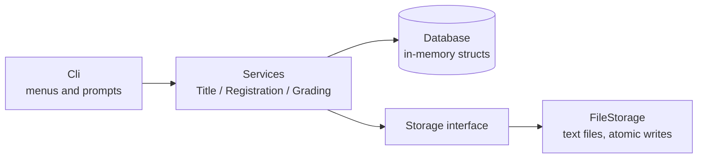

# FYP Management System

[](https://github.com/zijing0907/fyp-manager/actions/workflows/ci.yml)


[](LICENSE)

A C++17 command-line system for managing **final-year-project (FYP) titles, student registration and grading**. Data persists in plain text files, the business logic is separated from the UI and storage, and the core is covered by automated tests.

**Tech:** C++17 · CMake · GoogleTest · GitHub Actions (Linux + macOS) · AddressSanitizer / UBSan

## Background

This started as a group assignment for *UECS1004/UECS1104 Programming and Problem Solving* at UTAR (June 2025): a four-person team, one 800-line source file, global arrays. I was the team coordinator. I wrote the student registration and title management features and did most of the debugging and code-style work for the rest of the team.

This repository is my redesign of that program: a layered architecture, stable identifiers, a consistent grading model, input validation, and a test suite that pins down the bugs I found in the original.

## Features

**Lecturer**

| | |
| --- | --- |
| Titles | list, search, add, **modify**, delete (with confirmation) |
| Students | register, list, confirm a student to one of their shortlisted titles |
| Grading | enter supervisor / moderator marks for FYP1 and FYP2, view a student's result, class summary |

**Student** (logs in once with their ID)

| | |
| --- | --- |
| Titles | view all titles with availability, keyword search |
| Shortlist | add / remove up to 3 titles, view shortlist and confirmed title |

Grading details:

* Supervisor and moderator scores are averaged per phase, and the final mark is 30 % FYP1 + 70 % FYP2.
* A warning is printed when the two assessors' scores differ by **more than 5 marks**, both at entry time and in reports. Raw marks are never altered.
* The class summary counts Distinction / Pass / Fail / Incomplete and reports mean, highest and lowest final mark.

## Quick start

Requires CMake 3.16+ and a C++17 compiler (tested with Apple clang 17).

```bash
cmake -S . -B build
cmake --build build

cp -r sample_data data      # a working copy the program is free to edit
./build/fyp_manager         # or: ./build/fyp_manager --data path/to/folder
```

Run the tests (GoogleTest is downloaded automatically at configure time; add `-DFYP_BUILD_TESTS=OFF` to skip):

```bash
ctest --test-dir build --output-on-failure
```

The sample data has 30 FYP titles, 7 fictional students and marks that exercise every outcome. Missing data files are treated as empty, so `--data some/new/folder` starts a blank system.

## Sample session

Lecturer → *Class summary*, then *Student result* for a student whose supervisor and moderator disagree:

```text
--- Class Summary ---
ID        Name                         FYP1     FYP2    Final  Outcome
2400001   Alice Tan                   82.28    87.46    85.91  Distinction
2400002   Bob Lim                     62.28    61.98    62.07  Pass
2400003   Chloe Wong                  42.28    38.08    39.34  Fail
2400004   Daniel Lee                  71.08    74.92    73.77  Pass  (!)
2400005   Emily Ng                    70.15        -        -  Incomplete

Students with a confirmed title: 5
Distinction: 1  |  Pass: 2  |  Fail: 1  |  Incomplete: 1
Final mark: mean 65.27, highest 85.91, lowest 39.34
(!) 1 student(s) with supervisor/moderator scores more than 5 marks apart.

--- Result: Daniel Lee (2400004) ---
Title: T012  Web Application Development for Person Counting

                Supervisor   Moderator     Average
FYP1 (30%)           79.17       63.00       71.08
FYP2 (70%)           79.07       70.77       74.92
! FYP1: supervisor and moderator differ by 16.17 (more than 5 marks)
! FYP2: supervisor and moderator differ by 8.30 (more than 5 marks)

Final mark: 73.77  ->  Pass
```

For scripted demos, `--echo` repeats each input line so a piped session reads like a transcript:

```bash
printf '1\n11\ne\ne\n' | ./build/fyp_manager --data sample_data --echo
```

## How it is built



```
include/fyp/   public headers        src/    implementations        tests/   GoogleTest suite
sample_data/   starter data set      docs/   design notes
```

* **Model** – plain structs (`Title`, `Student`, `MarkEntry`) in an in-memory `Database`. Titles have stable ids (`T001`…) so nothing breaks when another title is deleted.
* **Services** – `TitleService`, `RegistrationService`, `GradingService` hold all business rules. They return a `Status` and never print or read input.
* **Storage** – an abstract `Storage` interface with a `FileStorage` implementation: `|`-delimited text files, escaping, CRLF tolerance, per-record error recovery, and atomic write-then-rename saves.
* **CLI** – menus and prompts over injected `std::istream` / `std::ostream`, ending cleanly at end-of-input.

The full picture, file formats and the grading formula are in [docs/design.md](docs/design.md).

## Testing

The suite covers the services, the file format (round trips, malformed lines, CRLF, crash-safety), and complete scripted CLI sessions. It also has a dedicated regression test for each defect found in the original program, for example:

* the menu loop that never terminated at end-of-input (about 156 MB of output in 3 seconds),
* confirmed titles that were forgotten on restart and then attributed to the wrong students,
* shortlists silently rewritten when an unrelated title was deleted,
* missing marks stored as `-1` and fed into the formulas.

The application code compiles warning-free with `-Wall -Wextra -Wpedantic -Wshadow -Wconversion`, and the suite also passes under UndefinedBehaviorSanitizer. Configure with `-DFYP_SANITIZE=ON` to add AddressSanitizer. `.github/workflows/ci.yml` builds and tests on Linux and macOS, plus a sanitizer job on Linux.

## Limitations and next steps

* Lecturer/student modes are separated in the UI only; there is no authentication.
* Files are replaced atomically one at a time, not as a single transaction. Swapping `FileStorage` for a SQLite-backed `Storage` would fix that without touching the services.
* Supervisor/moderator assignments are not modelled, so the assessor role is chosen at entry time.
* Sample students, marks and assignments are fictional. The 30 titles come from the original coursework data set.

## License

[MIT](LICENSE)
