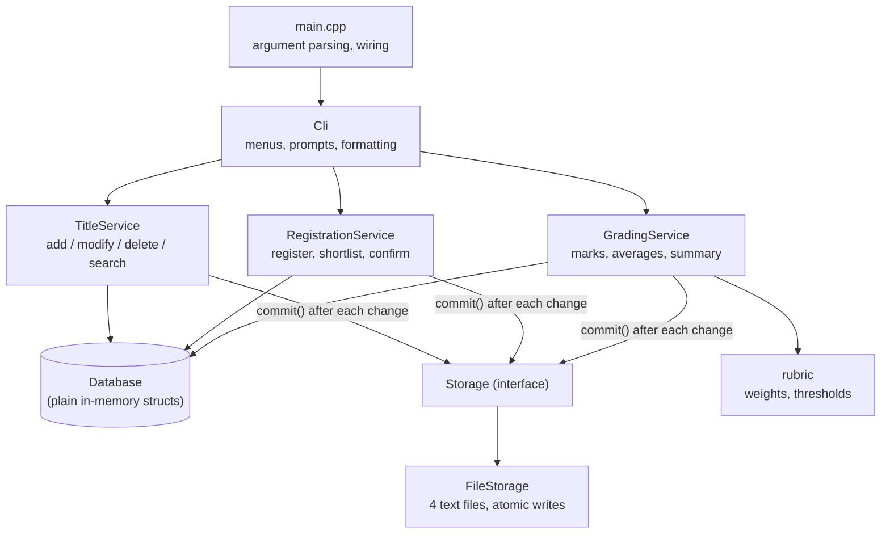

# Design notes

## Layers



| Layer | Files | Knows about |
| --- | --- | --- |
| Model | `models.hpp` | nothing (plain structs + lookup helpers) |
| Rubric | `rubric.hpp` | model |
| Services | `title_`, `registration_`, `grading_service.hpp` | model, rubric, `Storage` interface |
| Storage | `storage.hpp`, `serialization.hpp` | model |
| UI | `cli.hpp` | services (never touches files directly) |

Rules that keep it testable:

* **Services never print and never read `std::cin`.** They return a `Status` (ok + user-facing message), so every business rule can be unit-tested without a terminal.
* **The CLI takes `std::istream&` / `std::ostream&`**, so a whole session can be scripted in a test (`tests/cli_test.cpp`).
* **Services depend on the abstract `Storage`**, so tests use an in-memory fake and the real files can later be replaced by SQLite without touching any business logic.
* **The clock is injected** into `GradingService`, so timestamps are deterministic in tests.

## Data model and files

Titles are referenced by a **stable id** (`T001`, `T002`, …) rather than by array position. A title is "taken" when its `studentId` field is set, so the assignment lives in exactly one place instead of being duplicated across a flag file and a student record.

| File | Record | Notes |
| --- | --- | --- |
| `titles.txt` | `id \| title \| assigned_student_id` | student id empty while available |
| `students.txt` | `student_id \| name` | 7-digit id |
| `shortlists.txt` | `student_id \| T001,T002,T003` | order = pick order |
| `grades.txt` | `student_id \| FYP1/FYP2 \| supervisor/moderator \| m1,m2,… \| timestamp` | raw marks, not weighted totals |

Format rules: one record per line, `#` comments and blank lines ignored, CRLF or LF accepted, and `\\`, `\|`, `\n`, `\r` escaped inside fields so a title can contain a `|`. Readers never throw on bad data; they skip the line and return a warning naming the file and line number. After loading, `repairReferences` drops anything pointing at a student or title that no longer exists.

Writes go to `<file>.tmp` and are then renamed over the target, so a crash mid-write cannot leave a half-written file.

## Grading model

Each assessor marks every applicable criterion out of 100 (moderators do not mark *Effort*):

| Phase | Criterion (weight) | Supervisor | Moderator |
| --- | --- | --- | --- |
| FYP1 | Report (15), Presentation (10), Effort (5) | all 3 | first 2 |
| FYP2 | Final Report (20), Product Demo (35), Presentation (10), Effort (5) | all 4 | first 3 |

```
assessor score  = Σ(mark × weight) / Σ(weight of the criteria that role marks)      → 0–100
phase average   = (supervisor score + moderator score) / 2
final mark      = 0.30 × FYP1 average + 0.70 × FYP2 average
```

* **Discrepancy check:** if the supervisor and moderator scores for a phase differ by more than **5**, a warning is shown when the marks are entered, in the student's result, and in the class summary. The average is still used and the raw marks are never modified. The gap is rounded to two decimals first so floating-point noise cannot flip the result.
* **Outcome:** ≥ 75 Distinction, ≥ 50 Pass, otherwise Fail, decided on the two-decimal mark that is displayed. A student is **Incomplete** (and excluded from pass/fail counts and statistics) until all four assessments exist.
* All weights and thresholds are constants in `rubric.hpp`.

Because scores are normalised per role, a supervisor and a moderator who both rate the same work 80 get the same score, which is what a "more than 5 marks apart" rule needs to compare.

> **Behavioural change from the coursework version.** The original compared a 30-point supervisor total with a 25-point moderator total and patched the difference with a hard-coded `-5 / +5`. The final marks therefore differ slightly (for the same raw inputs the old code adds about 2.5 marks to each phase average). The new model is the same idea expressed consistently. If your course marking scheme differs, change `rubric.cpp`.

## Defects found in the original program

Each was reproduced by running the original binary, and each now has a regression test in `tests/regression_test.cpp`.

| # | Original behaviour | Fix |
| --- | --- | --- |
| 1 | At end-of-input the menu loop never exited: about 156 MB of "Invalid choice" in 3 seconds. | All input goes through one reader that throws on EOF; the CLI shuts down cleanly. |
| 2 | Only a "Taken" flag was saved. After a restart, any student who had shortlisted a taken title was shown as owning it. | The owning student's id is stored on the title itself. |
| 3 | Shortlists and confirmations stored array positions. Deleting one title silently changed other students' shortlists. | Titles have stable ids; deleting a title also removes it from shortlists. |
| 4 | Missing marks were stored as `-1` and used in the formulas, so a student with no FYP2 marks showed `FYP2 = 1.50` and a Fail. When marks were more than 5 apart, the raw marks were overwritten with their average and then adjusted again in reports (message said 22.5, report said 25.00). | Missing marks are `optional`; raw marks are never modified; incomplete students are reported as Incomplete. |
| 5 | Data file shipped as `titles.txt.txt`, and CRLF line endings broke the `"Taken"` comparison. | Correct file names; readers tolerate CRLF. |
| 6 | The brief says lecturers can *modify* titles; only add and delete existed. | Added modify. |

Smaller improvements: search matches all keywords in any order; students log in once instead of retyping their id for every action; a student can remove items from the shortlist instead of restarting it; marks entry asks before replacing existing marks; input is validated with clear messages everywhere.

## Known limitations

* **Single user, no authentication.** Lecturer and student modes are separated in the UI only. Real access control would need accounts.
* **Files are saved one at a time.** Each file is replaced atomically, but a failure between files could leave, say, `titles.txt` newer than `grades.txt`. Loading tolerates this (`repairReferences`), but a database with transactions (SQLite) would remove the problem. The `Storage` interface is where that would plug in.
* **Whole dataset is rewritten on every change.** Fine for hundreds of records; it would not scale to thousands.
* **No lecturer identities.** The brief mentions supervisors and moderators, but the original data has no lecturer names, so the role is chosen when marks are entered rather than checked against an assignment.
* The sample students, marks and title assignments are fictional. Only the 30 title strings come from the original coursework data.
